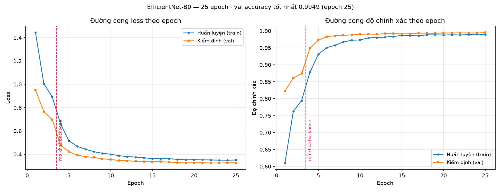
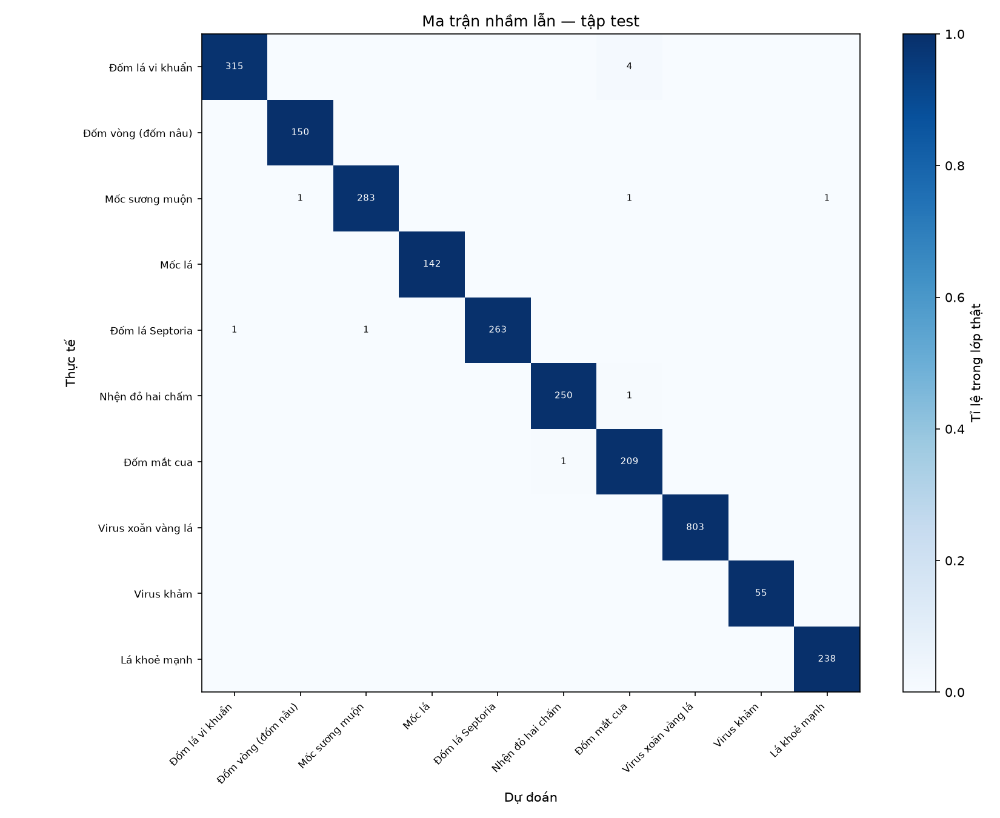
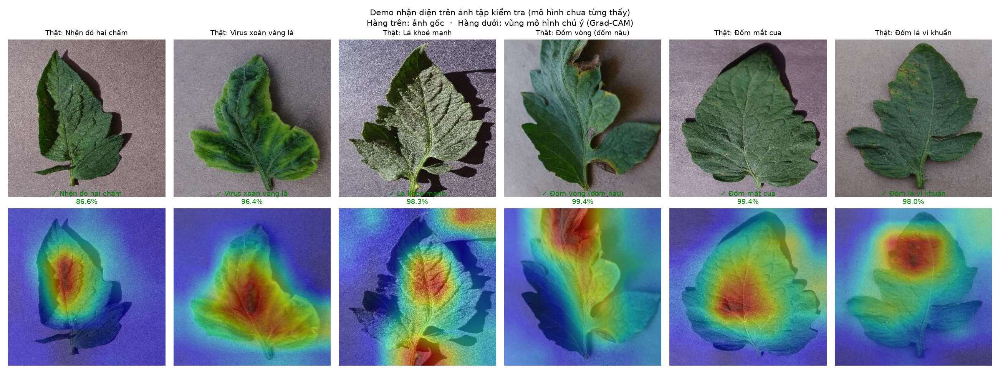

# BÁO CÁO KẾT QUẢ HUẤN LUYỆN MÔ HÌNH NHẬN DIỆN BỆNH LÁ CÀ CHUA

**Đề tài:** Ứng dụng nhận diện bệnh cây trồng kết hợp XAI (giải thích được)
**GVHD:** TS. Nguyễn Thị Lương — Khoa Công nghệ thông tin, Trường Đại học Đà Lạt
**Người thực hiện:** Đinh Lâm Gia Bảo (2212343) — phụ trách phần mô hình
**Ngày thực hiện:** 07/09/2026
**Công việc tương ứng:** Issue #14 (MD-05 — Huấn luyện đầy đủ) và #15 (MD-06 — Đánh giá tập test)

---

## MỤC LỤC

1. [Tóm tắt kết quả](#1-tóm-tắt-kết-quả)
2. [Giải thích thuật ngữ](#2-giải-thích-thuật-ngữ)
3. [Dữ liệu sử dụng](#3-dữ-liệu-sử-dụng)
4. [Cấu hình mô hình và huấn luyện](#4-cấu-hình-mô-hình-và-huấn-luyện)
5. [Diễn biến quá trình huấn luyện](#5-diễn-biến-quá-trình-huấn-luyện)
6. [Kết quả đánh giá trên tập kiểm tra](#6-kết-quả-đánh-giá-trên-tập-kiểm-tra)
7. [Phân tích lỗi và ma trận nhầm lẫn](#7-phân-tích-lỗi-và-ma-trận-nhầm-lẫn)
8. [Demo nhận diện trên ảnh đơn lẻ](#8-demo-nhận-diện-trên-ảnh-đơn-lẻ)
9. [Nhận định và cảnh báo quan trọng](#9-nhận-định-và-cảnh-báo-quan-trọng)
10. [Công việc tiếp theo](#10-công-việc-tiếp-theo)

---

## 1. Tóm tắt kết quả

Mô hình EfficientNet-B0 đã được huấn luyện đầy đủ 25 epoch trên 18.160 ảnh lá cà
chua thuộc 10 lớp bệnh. Kết quả trên tập kiểm tra — phần dữ liệu mô hình **chưa
từng nhìn thấy** trong suốt quá trình học:

**Bảng 1. Các chỉ số tổng hợp**

| Chỉ số | Giá trị |
|---|---|
| Độ chính xác trên tập kiểm tra (test accuracy) | **99,60 %** |
| Độ chính xác trên tập kiểm định (val accuracy) | 99,49 % |
| Top-3 accuracy | **100,00 %** |
| Macro F1 (trung bình 10 lớp, mỗi lớp tính ngang nhau) | **99,55 %** |
| Số ảnh dự đoán sai | **11 / 2.719 ảnh** |
| Thời gian huấn luyện | 29,6 phút (25 epoch) |
| Kích thước mô hình | 15,6 MB — 4.020.358 tham số |
| Phiên bản mô hình | `efficientnet_b0-20260907-1443` |

Kết quả đạt yêu cầu và vượt kỳ vọng ban đầu. Tuy nhiên **con số này chưa phản ánh
chất lượng thực tế ngoài đồng ruộng** — phần lý giải chi tiết ở mục 9, đây là nội
dung quan trọng nhất của báo cáo.

---

## 2. Giải thích thuật ngữ

Phần này dành cho người đọc không chuyên sâu về học máy. Các thuật ngữ được sắp
xếp theo trình tự xuất hiện trong báo cáo.

### 2.1. Thuật ngữ nền tảng

**Mạng nơ-ron tích chập (CNN — Convolutional Neural Network)**
Loại mô hình học sâu chuyên xử lý ảnh. Nó không nhìn ảnh như một danh sách điểm
ảnh rời rạc, mà quét qua ảnh bằng các bộ lọc nhỏ để phát hiện dần dần: lớp đầu bắt
cạnh và màu, lớp giữa bắt hình thù như đốm tròn hay đường gân, lớp cuối ghép lại
thành khái niệm như "vết bệnh nâu có quầng vàng".

**Backbone (phần xương sống / phần trích đặc trưng)**
Là phần lớn nhất của mô hình, làm nhiệm vụ **biến ảnh thành một danh sách con số
mô tả nội dung ảnh** (gọi là đặc trưng). Có thể ví backbone như phần "mắt và trí
nhớ thị giác": nó nhìn ảnh rồi tóm tắt lại thành đại ý "có nhiều đốm nâu tròn,
viền vàng, trên nền lá xanh". Trong đồ án này backbone là **EfficientNet-B0**.

**Đầu phân loại (classifier head)**
Phần nhỏ gắn ở cuối mô hình, nhận bản tóm tắt của backbone rồi **quyết định đó là
bệnh gì** trong 10 lớp. Nếu backbone là con mắt thì đầu phân loại là người bác sĩ
đọc mô tả rồi kết luận bệnh. Trong đồ án, đầu phân loại được thay mới hoàn toàn:
từ 1.000 lớp của bộ ImageNet xuống còn đúng 10 lớp bệnh cà chua.

**Học chuyển giao (transfer learning)**
Thay vì dạy mô hình từ số không, ta lấy một mô hình **đã học nhìn ảnh** từ trước
rồi dạy thêm phần chuyên môn. Backbone EfficientNet-B0 đã được huấn luyện sẵn trên
ImageNet — bộ 1,2 triệu ảnh đời thường (chó, mèo, xe cộ, hoa lá). Nó đã biết thế
nào là cạnh, đốm, kết cấu bề mặt; nhóm chỉ cần dạy tiếp cách phân biệt các loại
bệnh cà chua.

> **Vì sao bắt buộc phải làm vậy:** dữ liệu của nhóm chỉ có 18.160 ảnh, quá ít so
> với 1,2 triệu ảnh của ImageNet. Huấn luyện từ số không với chừng đó ảnh gần như
> chắc chắn cho kết quả kém.

**Đóng băng (freeze) và mở khoá (unfreeze) backbone**

- *Đóng băng* = tạm khoá backbone lại, không cho các con số bên trong nó thay đổi;
  chỉ huấn luyện riêng đầu phân loại.
- *Mở khoá* = cho phép toàn bộ mô hình, kể cả backbone, tiếp tục được điều chỉnh.

> **Vì sao phải đóng băng vài epoch đầu:** đầu phân loại mới tinh, các con số bên
> trong nó khởi tạo ngẫu nhiên, nên lúc đầu nó đoán sai rất nhiều. Nếu để cả mạng
> cùng học ngay, những "tín hiệu sửa sai" rất lớn từ đầu phân loại sẽ lan ngược vào
> backbone và **phá hỏng kiến thức tốt** mà backbone đã tích luỹ từ ImageNet. Đóng
> băng 3 epoch đầu giống như để người mới vào nghề đọc kết quả trước, chưa cho phép
> anh ta sửa lại cách nhìn của người có kinh nghiệm.

### 2.2. Thuật ngữ trong quá trình huấn luyện

**Epoch** — một lượt mô hình xem hết toàn bộ ảnh huấn luyện đúng một lần. Huấn
luyện 25 epoch nghĩa là mô hình được xem trọn bộ 12.722 ảnh huấn luyện 25 lần.

**Batch (lô) và batch size** — máy không đưa cả 12.722 ảnh vào cùng lúc vì không đủ
bộ nhớ, mà chia thành từng lô nhỏ. Cấu hình `batch_size = 32` nghĩa là mỗi lần xử
lý 32 ảnh; 12.722 ảnh chia cho 32 được khoảng 397 lô mỗi epoch.

**Loss (hàm mất mát)** — con số đo **mức độ sai** của mô hình: càng nhỏ càng tốt,
bằng 0 là hoàn hảo. Đây chính là đại lượng mô hình cố gắng giảm xuống trong suốt
quá trình học.

**Accuracy (độ chính xác)** — tỉ lệ ảnh mô hình đoán đúng. Giá trị 0,98 nghĩa là
đúng 98 ảnh trên 100 ảnh.

**Learning rate (tốc độ học)** — mức độ mô hình được phép thay đổi sau mỗi lần nhận
ra mình sai. Quá lớn thì mô hình "sửa quá tay", nhảy loạn không ổn định; quá nhỏ
thì học rất chậm. Trong đồ án, khi mở khoá backbone thì learning rate được **hạ
xuống còn 1/10** để việc tinh chỉnh diễn ra nhẹ nhàng, không phá kiến thức cũ.

**Tập huấn luyện / kiểm định / kiểm tra (train / validation / test)**

| Tập | Tỉ lệ | Vai trò | Ví von |
|---|---|---|---|
| Huấn luyện | 70 % | Ảnh mô hình được học trực tiếp | Bài tập về nhà |
| Kiểm định | 15 % | Ảnh mô hình **không** học, dùng để theo dõi và chọn phiên bản tốt nhất | Bài kiểm tra 15 phút |
| Kiểm tra | 15 % | Giữ kín hoàn toàn tới phút cuối, chỉ dùng một lần để báo cáo | Bài thi cuối kỳ |

**Quá khớp (overfitting)** — hiện tượng mô hình **học thuộc lòng** ảnh huấn luyện
thay vì hiểu quy luật chung, tức làm bài tập về nhà rất giỏi nhưng đi thi thì kém.
Dấu hiệu nhận biết: loss trên tập huấn luyện tiếp tục giảm trong khi loss trên tập
kiểm định lại **tăng lên**.

**Dừng sớm (early stopping)** — cơ chế tự dừng huấn luyện khi mô hình đã hết tiến
bộ, nhằm tiết kiệm thời gian và tránh quá khớp. Cấu hình của nhóm: nếu 6 epoch liên
tiếp không cải thiện thì dừng.

**Tăng cường dữ liệu (data augmentation)** — trong lúc huấn luyện, mỗi ảnh được biến
đổi ngẫu nhiên (lật, xoay, đổi sáng tối, cắt cúp) để mô hình thấy nhiều biến thể
khác nhau của cùng một chiếc lá. Mục đích là dạy mô hình nhận ra bệnh **bất kể góc
chụp và điều kiện ánh sáng** — rất quan trọng vì ảnh nông dân chụp ngoài đồng đa
dạng hơn ảnh chụp trong phòng thí nghiệm rất nhiều.

**Checkpoint** — file lưu lại toàn bộ trạng thái mô hình tại một thời điểm. File
`best.pt` là bản có độ chính xác trên tập kiểm định cao nhất, **không nhất thiết là
bản của epoch cuối cùng**.

### 2.3. Thuật ngữ khi đọc kết quả

**Precision (độ chuẩn xác)** — trong những ảnh mô hình **nói là** bệnh này, bao
nhiêu phần trăm đúng thật. Precision thấp nghĩa là hay báo động nhầm.

**Recall (độ bao phủ)** — trong những ảnh **thật sự** là bệnh này, mô hình bắt được
bao nhiêu phần trăm. Recall thấp nghĩa là hay bỏ sót bệnh.

> **Với ứng dụng nông nghiệp, recall thấp nguy hiểm hơn precision thấp**: bỏ sót
> bệnh khiến nông dân không xử lý kịp và thiệt hại lan rộng, trong khi báo nhầm chỉ
> khiến họ mất công kiểm tra lại.

**F1-score** — điểm tổng hợp cân bằng giữa precision và recall (trung bình điều
hoà). Dùng khi cần một con số duy nhất để so sánh các lớp với nhau.

**Macro F1** — trung bình F1 của cả 10 lớp, **mỗi lớp tính ngang nhau** bất kể lớp
đó nhiều ảnh hay ít ảnh. Chỉ số này đặc biệt quan trọng với đồ án vì dữ liệu lệch
lớp tới 14,4 lần: độ chính xác tổng có thể bị "kéo đẹp" bởi các lớp đông ảnh, còn
macro F1 thì không bị.

**Top-3 accuracy** — tỉ lệ ảnh mà đáp án đúng nằm trong **3 dự đoán khả dĩ nhất**
của mô hình. Chỉ số này có ý nghĩa thực tiễn: giao diện có thể hiển thị 3 khả năng
để nông dân đối chiếu thêm, thay vì ép một đáp án duy nhất.

**Ma trận nhầm lẫn (confusion matrix)** — bảng vuông 10×10 trong đó hàng là bệnh
**thật**, cột là bệnh mô hình **đoán**. Ô nằm trên đường chéo là số ảnh đoán đúng;
ô ngoài đường chéo cho biết lớp nào hay bị nhầm thành lớp nào. Đây là công cụ chẩn
đoán lỗi trực quan nhất — nhìn vào là biết mô hình yếu ở đâu.

**Lệch lớp (class imbalance)** — tình trạng các lớp có số lượng ảnh chênh nhau
nhiều. Bộ dữ liệu của nhóm lệch **14,4 lần**. Hệ quả: mô hình có xu hướng thiên về
lớp đông ảnh, và chỉ số của lớp ít ảnh sẽ nhiễu hơn.

**Khoảng cách miền (domain gap)** — sự khác biệt giữa dữ liệu huấn luyện và dữ liệu
thực tế khi triển khai. Xem mục 9.1.

### 2.4. Thuật ngữ về tính giải thích được (XAI)

**XAI (Explainable AI)** — nhóm kỹ thuật giúp con người hiểu **vì sao** mô hình đưa
ra kết luận, thay vì chỉ nhận một đáp án từ "hộp đen".

**Grad-CAM** — kỹ thuật tạo **bản đồ nhiệt** chỉ ra vùng nào trên ảnh khiến mô hình
đưa ra kết luận đó: vùng đỏ ảnh hưởng nhiều, vùng xanh ảnh hưởng ít. Trong đồ án,
bản đồ nhiệt này được chuyển tiếp thành vùng khoanh đơn giản kèm một câu tiếng Việt
để nông dân dễ hiểu.

**Học tắt (shortcut learning)** — lỗi nguy hiểm khi mô hình đạt điểm cao nhưng
**dựa vào dấu hiệu sai**, ví dụ nhìn màu nền hoặc mép lá thay vì nhìn vết bệnh. Mô
hình kiểu này sập ngay khi gặp ảnh thật. Đây chính là lý do phải kiểm tra Grad-CAM
bằng mắt trước khi cho hiển thị tới người dùng.

---

## 3. Dữ liệu sử dụng

Bộ dữ liệu **PlantVillage** (phần cà chua, bản màu), tải từ Kaggle ngày 20/08/2026,
gồm **18.160 ảnh RGB kích thước 256×256** thuộc 10 lớp. Dữ liệu được chia theo tỉ lệ
70/15/15 **trong từng lớp** (không chia ngẫu nhiên toàn cục) để mọi lớp đều có mặt
đầy đủ ở cả ba tập.

**Bảng 2. Phân bố dữ liệu theo lớp và theo tập**

| Lớp bệnh | Huấn luyện | Kiểm định | Kiểm tra | Tổng |
|---|---:|---:|---:|---:|
| Đốm lá vi khuẩn | 1.489 | 319 | 319 | 2.127 |
| Đốm vòng | 700 | 150 | 150 | 1.000 |
| Mốc sương muộn | 1.337 | 286 | 286 | 1.909 |
| Mốc lá | 668 | 142 | 142 | 952 |
| Đốm lá Septoria | 1.241 | 265 | 265 | 1.771 |
| Nhện đỏ hai chấm | 1.174 | 251 | 251 | 1.676 |
| Đốm mắt cua | 984 | 210 | 210 | 1.404 |
| Virus xoăn vàng lá | 3.751 | 803 | 803 | 5.357 |
| Virus khảm | 263 | 55 | 55 | 373 |
| Lá khoẻ mạnh | 1.115 | 238 | 238 | 1.591 |
| **Tổng cộng** | **12.722** | **2.719** | **2.719** | **18.160** |

Việc chia tập đã được kiểm chứng: không có ảnh nào xuất hiện ở hai tập khác nhau
(tránh rò rỉ dữ liệu làm thổi phồng kết quả), và chạy lại hai lần cho kết quả trùng
khớp từng byte nhờ cố định seed = 42.

**Đặc điểm cần lưu ý:** dữ liệu **lệch lớp 14,4 lần** — lớp *Virus xoăn vàng lá* có
5.357 ảnh trong khi lớp *Virus khảm* chỉ có 373 ảnh. Đây là đặc tính vốn có của bộ
dữ liệu gốc, không phải sai sót khi thu thập.

---

## 4. Cấu hình mô hình và huấn luyện

**Bảng 3. Cấu hình sử dụng** (trích từ `model/configs/default.yaml`)

| Nhóm | Tham số | Giá trị | Ý nghĩa |
|---|---|---|---|
| Mô hình | Kiến trúc | EfficientNet-B0 | Mạng CNN nhẹ, 4.020.358 tham số |
| | Trọng số khởi tạo | ImageNet | Học chuyển giao, không huấn luyện từ số không |
| | Dropout | 0,3 | Kỹ thuật chống quá khớp: bỏ ngẫu nhiên 30 % kết nối khi học |
| Dữ liệu | Kích thước ảnh vào | 224 × 224 | Ảnh gốc 256×256 được cắt/thu về kích thước này |
| | Batch size | 32 | Số ảnh xử lý mỗi lần |
| | Số tiến trình nạp dữ liệu | 8 | Tham số hạ tầng, xem mục 5.3 |
| Huấn luyện | Số epoch | 25 | |
| | Thuật toán tối ưu | AdamW | |
| | Learning rate | 0,0003 | Giảm còn 0,00003 sau khi mở khoá backbone |
| | Số epoch đóng băng | 3 | Giai đoạn một |
| | Label smoothing | 0,05 | Kỹ thuật chống mô hình quá tự tin |
| | Dừng sớm | 6 epoch | Ngưỡng kiên nhẫn |
| | Mixed precision | Bật | Tính toán độ chính xác hỗn hợp, tăng tốc trên GPU |

**Chiến lược huấn luyện hai giai đoạn:**

| Giai đoạn | Epoch | Trạng thái backbone | Learning rate |
|---|---|---|---|
| Giai đoạn 1 | 1 – 3 | Đóng băng (chỉ học đầu phân loại) | 0,0003 |
| Giai đoạn 2 | 4 – 25 | Mở khoá toàn bộ (tinh chỉnh) | 0,00003 |

**Môi trường thực nghiệm:** GPU NVIDIA RTX 4060 Ti (8 GB VRAM), CPU 16 luồng,
Python 3.12.1, PyTorch 2.13.0+cu126, Windows 11.

---

## 5. Diễn biến quá trình huấn luyện

### 5.1. Bảng số liệu từng epoch

**Bảng 4. Kết quả 25 epoch**

| Epoch | Train loss | Train accuracy | Val loss | Val accuracy | Ghi chú |
|---:|---:|---:|---:|---:|---|
| 1 | 1,4435 | 0,6101 | 0,9495 | 0,8224 | Giai đoạn 1 — đóng băng backbone |
| 2 | 1,0043 | 0,7624 | 0,7657 | 0,8610 | |
| 3 | 0,8934 | 0,7946 | 0,6980 | 0,8742 | Kết thúc giai đoạn 1 |
| 4 | 0,6611 | 0,8783 | 0,4795 | 0,9489 | **Mở khoá backbone**, lr → 0,00003 |
| 5 | 0,5158 | 0,9309 | 0,4224 | 0,9724 | |
| 6 | 0,4682 | 0,9506 | 0,3915 | 0,9834 | Vượt mốc 98 % |
| 7 | 0,4425 | 0,9575 | 0,3802 | 0,9857 | |
| 8 | 0,4223 | 0,9673 | 0,3723 | 0,9868 | |
| 9 | 0,4084 | 0,9724 | 0,3610 | 0,9882 | |
| 10 | 0,4002 | 0,9733 | 0,3551 | 0,9897 | |
| 11 | 0,3878 | 0,9793 | 0,3470 | 0,9908 | Vượt mốc 99 % |
| 12 | 0,3802 | 0,9801 | 0,3450 | 0,9901 | Không cải thiện (1/6) |
| 13 | 0,3757 | 0,9818 | 0,3388 | 0,9919 | |
| 14 | 0,3696 | 0,9835 | 0,3366 | 0,9923 | |
| 15 | 0,3628 | 0,9869 | 0,3360 | 0,9912 | Không cải thiện (1/6) |
| 16 | 0,3627 | 0,9861 | 0,3367 | 0,9915 | Không cải thiện (2/6) |
| 17 | 0,3625 | 0,9854 | 0,3324 | 0,9934 | |
| 18 | 0,3561 | 0,9884 | 0,3283 | 0,9934 | Bằng kỷ lục, không lưu |
| 19 | 0,3525 | 0,9882 | 0,3268 | 0,9926 | |
| 20 | 0,3537 | 0,9878 | 0,3270 | 0,9937 | |
| 21 | 0,3521 | 0,9884 | 0,3277 | 0,9937 | |
| 22 | 0,3512 | 0,9880 | 0,3256 | 0,9941 | |
| 23 | 0,3497 | 0,9890 | 0,3250 | 0,9937 | |
| 24 | 0,3488 | 0,9904 | 0,3275 | 0,9937 | |
| **25** | **0,3509** | **0,9891** | **0,3266** | **0,9949** | **Tốt nhất — lưu `best.pt`** |

### 5.2. Biểu đồ đường cong huấn luyện

**Hình 1.** Đường cong loss (trái) và độ chính xác (phải) theo epoch. Đường dọc màu
đỏ đánh dấu thời điểm mở khoá backbone giữa epoch 3 và 4.

**Ba nhận xét rút ra từ Hình 1 và Bảng 4:**

**a) Hiệu quả rõ rệt của chiến lược hai giai đoạn.** Trong 3 epoch đóng băng, độ
chính xác chỉ đạt 87,42 % vì mô hình bị giới hạn ở việc dùng đặc trưng chung của
ImageNet. Ngay epoch 4 — epoch đầu tiên sau khi mở khoá — độ chính xác **nhảy vọt
7,5 điểm phần trăm** lên 94,89 %. Đây là bằng chứng thực nghiệm cho thấy việc tinh
chỉnh backbone là cần thiết, và cũng cho thấy chiến lược đóng băng trước rồi mở
khoá sau đã hoạt động đúng như thiết kế.

**b) Không có dấu hiệu quá khớp.** Trong suốt 25 epoch, val loss **giảm liên tục**
từ 0,9495 xuống 0,3266 song hành cùng train loss, chứ không tăng lên như trường hợp
quá khớp điển hình. Đáng chú ý ở các epoch 18–23: độ chính xác gần như đứng yên
quanh 99,3 % nhưng val loss vẫn tiếp tục giảm — nghĩa là mô hình ngày càng **tự tin
hơn vào những dự đoán vốn đã đúng**, một dấu hiệu lành mạnh.

**c) Mô hình đã hội tụ nhưng chưa dừng sớm.** Từ epoch 17 trở đi, độ chính xác dao
động rất hẹp trong khoảng 99,26 – 99,49 %. Cơ chế dừng sớm (ngưỡng 6 epoch) đã được
kích hoạt ba lần nhưng luôn bị reset vì mô hình lại nhích lên được. Kết quả tốt nhất
rơi vào đúng epoch 25 cuối cùng.

**d) Vì sao đường kiểm định lại nằm *cao hơn* đường huấn luyện?**

Nhìn Hình 1 sẽ thấy một hiện tượng thoạt nhìn có vẻ nghịch lý: độ chính xác trên tập
kiểm định (đường cam) **luôn cao hơn** trên tập huấn luyện (đường xanh), và val loss
cũng luôn **thấp hơn** train loss. Thông thường người ta kỳ vọng điều ngược lại, vì
mô hình được học trực tiếp trên tập huấn luyện.

Đây **không phải lỗi**, mà là hệ quả trực tiếp của hai kỹ thuật chống quá khớp:

1. **Tăng cường dữ liệu chỉ áp dụng cho tập huấn luyện.** Mỗi ảnh huấn luyện đều bị
   xoay, lật, đổi sáng tối, cắt cúp và làm mờ ngẫu nhiên trước khi đưa vào mô hình —
   tức mô hình đang làm một **bài toán khó hơn hẳn**. Ảnh kiểm định thì để nguyên,
   sạch sẽ, dễ nhận ra hơn nhiều.
2. **Dropout chỉ bật khi huấn luyện.** Trong lúc học, 30 % kết nối bị tắt ngẫu nhiên
   để mô hình không ỷ lại vào một vài đặc trưng; khi đánh giá thì toàn bộ mạng được
   dùng đầy đủ. Nói cách khác, lúc học mô hình bị "trói một tay sau lưng".

Ví von: điểm luyện tập thấp hơn điểm thi vì lúc luyện tập thì tạ nặng hơn và điều
kiện khắc nghiệt hơn. **Đây là dấu hiệu tốt** — nó cho thấy mô hình còn dư năng lực
và chắc chắn chưa quá khớp. Nếu quan sát thấy điều ngược lại (train cao vọt, val
tụt) thì mới là lúc phải lo.

> **Ghi chú phương pháp:** việc epoch cuối cùng lại là epoch tốt nhất gợi ý rằng
> huấn luyện thêm có thể còn cải thiện chút ít. Tuy nhiên mức tăng ở giai đoạn này
> chỉ còn khoảng 0,1 điểm phần trăm mỗi vài epoch, không đáng kể so với sai số thống
> kê trên tập kiểm định 2.719 ảnh. Nhóm giữ nguyên 25 epoch theo cấu hình đã định
> trước để bảo đảm tính tái lập của thực nghiệm.

### 5.3. Ghi nhận về hiệu năng

Thời gian huấn luyện thực tế: **29,6 phút** cho 25 epoch, tương đương khoảng 71
giây mỗi epoch (bao gồm cả pha kiểm định).

Trước khi chạy chính thức, nhóm đã thực hiện một lượt chạy thử 1 epoch và phát hiện
**GPU phải chờ CPU** khoảng 12 giây mỗi epoch do khâu đọc và giải mã ảnh JPEG không
theo kịp. Sau khi tăng số tiến trình nạp dữ liệu từ 4 lên 8 (máy có 16 luồng CPU),
thời gian mỗi epoch giảm từ khoảng 42 giây xuống khoảng 35 giây, và mức sử dụng GPU
tăng từ dao động 1–59 % lên ổn định 86 %.

> **Cần nói rõ khi bảo vệ:** đây là **tham số hạ tầng**, không phải siêu tham số của
> mô hình. Nó chỉ thay đổi tốc độ chuẩn bị dữ liệu, không thay đổi dữ liệu, kiến
> trúc hay trọng số — do đó không hề "làm đẹp" kết quả. Về bản chất nó cùng loại với
> việc chuyển dữ liệu sang ổ đĩa nhanh hơn.

Ước lượng ban đầu của nhóm là 22–25 phút; thực tế 29,6 phút, tức **chậm hơn khoảng
20 %** so với dự kiến. Nguyên nhân là ước lượng cũ chỉ ngoại suy từ pha huấn luyện
mà chưa tính đầy đủ pha kiểm định chạy sau mỗi epoch. Sai lệch này không ảnh hưởng
tiến độ nhưng được ghi nhận để các ước lượng sau chính xác hơn.

---

## 6. Kết quả đánh giá trên tập kiểm tra

Đánh giá được thực hiện trên **2.719 ảnh của tập kiểm tra** — phần dữ liệu được
giữ kín hoàn toàn, mô hình chưa từng nhìn thấy dù chỉ một lần trong suốt quá trình
huấn luyện.

**Bảng 5. Chỉ số chi tiết theo từng lớp**

| Lớp bệnh | Precision | Recall | F1-score | Số ảnh |
|---|---:|---:|---:|---:|
| Đốm lá vi khuẩn | 0,9968 | 0,9875 | 0,9921 | 319 |
| Đốm vòng | 0,9934 | **1,0000** | 0,9967 | 150 |
| Mốc sương muộn | 0,9965 | 0,9895 | 0,9930 | 286 |
| Mốc lá | **1,0000** | **1,0000** | **1,0000** | 142 |
| Đốm lá Septoria | **1,0000** | 0,9925 | 0,9962 | 265 |
| Nhện đỏ hai chấm | 0,9960 | 0,9960 | 0,9960 | 251 |
| Đốm mắt cua | 0,9721 | 0,9952 | 0,9835 | 210 |
| Virus xoăn vàng lá | **1,0000** | **1,0000** | **1,0000** | 803 |
| Virus khảm | **1,0000** | **1,0000** | **1,0000** | 55 |
| Lá khoẻ mạnh | 0,9958 | **1,0000** | 0,9979 | 238 |
| **Trung bình (macro)** | **0,9951** | **0,9961** | **0,9955** | **2.719** |

**Ba điểm đáng chú ý:**

**a) Lớp ít ảnh nhất lại đạt kết quả tuyệt đối.** Lớp *Virus khảm* chỉ có 263 ảnh
huấn luyện (ít hơn lớp đông nhất 14,4 lần) nhưng đạt precision, recall và F1 đều
bằng 1,0000 — không sai một ảnh nào trong 55 ảnh kiểm tra. Kết quả này **vượt ngoài
dự đoán ban đầu**: nhóm đã cảnh báo trước rằng lớp này có thể có recall thấp do lệch
lớp. Lý giải: triệu chứng virus khảm (lá nhăn nhúm, khảm màu xanh đậm xen xanh nhạt)
rất khác biệt về mặt thị giác so với 9 lớp còn lại, nên số lượng ảnh ít vẫn đủ để
mô hình học được đặc trưng phân biệt.

> **Bài học phương pháp:** lệch lớp là *nguy cơ* chứ không phải *hậu quả tất yếu*.
> Mức độ ảnh hưởng phụ thuộc vào việc lớp thiểu số có đặc trưng thị giác riêng biệt
> hay không. Đây là lý do phải đo chỉ số từng lớp thay vì chỉ nhìn độ chính xác tổng.

**b) Lớp *Đốm mắt cua* có precision thấp nhất (0,9721).** Nghĩa là trong những ảnh
mô hình gán nhãn "đốm mắt cua", có khoảng 2,8 % thực ra là bệnh khác — chủ yếu là
đốm lá vi khuẩn. Xem phân tích ở mục 7.

**c) Không lớp nào có recall dưới 0,9875.** Với ứng dụng nông nghiệp thì đây là chỉ
số quan trọng nhất: mô hình **hiếm khi bỏ sót bệnh**. Đặc biệt lớp *Lá khoẻ mạnh*
đạt recall 1,0000, nghĩa là không có lá khoẻ nào bị báo nhầm thành bệnh — tránh
được việc nông dân phun thuốc oan.

---

## 7. Phân tích lỗi và ma trận nhầm lẫn

**Hình 2.** Ma trận nhầm lẫn trên tập kiểm tra (đã chuẩn hoá theo hàng). Hàng là
bệnh thật, cột là bệnh mô hình dự đoán. Ô càng đậm tỉ lệ càng cao.

Toàn bộ mô hình chỉ dự đoán sai **11 ảnh trên 2.719 ảnh** (0,40 %). Liệt kê đầy đủ:

**Bảng 6. Toàn bộ các trường hợp dự đoán sai**

| # | Bệnh thật | Mô hình đoán thành | Số ảnh | Đánh giá mức hợp lý |
|---|---|---|---:|---|
| 1 | Đốm lá vi khuẩn | Đốm mắt cua | 4 | Hợp lý — cùng là đốm nâu nhỏ trên phiến lá |
| 2 | Mốc sương muộn | Đốm vòng | 1 | Hợp lý — cùng tạo mảng nâu lan rộng |
| 3 | Mốc sương muộn | Đốm mắt cua | 1 | Hợp lý |
| 4 | Mốc sương muộn | **Lá khoẻ mạnh** | 1 | **Đáng lưu ý** — xem phân tích dưới |
| 5 | Đốm lá Septoria | Đốm lá vi khuẩn | 1 | Hợp lý — hai bệnh đốm nhỏ rất giống nhau |
| 6 | Đốm lá Septoria | Mốc sương muộn | 1 | Hợp lý |
| 7 | Nhện đỏ hai chấm | Đốm mắt cua | 1 | Hợp lý — tổn thương đều li ti, rải rác |
| 8 | Đốm mắt cua | Nhện đỏ hai chấm | 1 | Hợp lý — nhầm ngược lại của trường hợp 7 |

**Cặp lớp bị nhầm nhiều nhất: *Đốm lá vi khuẩn* → *Đốm mắt cua* (4 ảnh).**

Nhầm lẫn này **hoàn toàn hợp lý về mặt bệnh học**: cả hai bệnh đều biểu hiện bằng
các đốm nâu sẫm đường kính vài milimet nằm rải rác trên phiến lá. Khác biệt chính là
đốm lá vi khuẩn thường có quầng vàng bao quanh và bề mặt sần sùi, còn đốm mắt cua có
vòng đồng tâm giống mắt cua — hai dấu hiệu này rất nhỏ và dễ mờ đi khi ảnh bị thu về
kích thước 224×224. Ngay cả chuyên gia nông nghiệp cũng cần quan sát kỹ mới phân
biệt được hai bệnh này qua ảnh.

**Trường hợp đáng lưu ý nhất: 1 ảnh *Mốc sương muộn* bị đoán thành *Lá khoẻ mạnh*.**

Đây là loại lỗi nghiêm trọng hơn hẳn các lỗi còn lại, vì hậu quả không đối xứng:
nhầm bệnh A thành bệnh B thì nông dân vẫn biết cây đang có vấn đề và sẽ xử lý; còn
nhầm bệnh thành **khoẻ mạnh** thì họ hoàn toàn không hành động, trong khi mốc sương
muộn là bệnh lây lan cực nhanh, có thể mất trắng cả ruộng trong vài ngày.

Tuy nhiên cần đặt đúng tỉ lệ: đây là **1 ảnh trên 286 ảnh** mốc sương muộn (0,35 %),
và là trường hợp duy nhất trong toàn bộ tập kiểm tra mà bệnh bị đoán thành khoẻ.
Chiều ngược lại — lá khoẻ bị đoán thành bệnh — **không xảy ra lần nào**.

> **Đề xuất xử lý ở giai đoạn tích hợp:** thay vì cố ép mô hình đạt 100 %, nên tận
> dụng chỉ số **top-3 accuracy = 100 %** đã đo được. Nghĩa là đáp án đúng *luôn* nằm
> trong 3 dự đoán hàng đầu của mô hình. Giao diện có thể hiển thị 3 khả năng kèm độ
> tin cậy khi mô hình không chắc chắn, để nông dân tự đối chiếu — vừa an toàn hơn,
> vừa đúng tinh thần XAI của đề tài là hỗ trợ quyết định chứ không thay thế con người.

**Không có nhầm lẫn nào vô lý về mặt bệnh học.** Toàn bộ 11 ảnh sai đều rơi vào các
cặp bệnh có triệu chứng thị giác tương đồng. Điều này cho thấy mô hình đang học
đúng hướng — nó nhầm ở đúng những chỗ mà con người cũng dễ nhầm, chứ không nhầm lung
tung theo kiểu học tắt.

---

## 8. Demo nhận diện trên ảnh đơn lẻ

Các chỉ số ở mục 6 và 7 là kết quả đánh giá hàng loạt. Để kiểm chứng rằng hệ thống
thực sự chạy được trên **từng ảnh riêng lẻ đúng như khi triển khai**, nhóm đã thực
hiện một lượt demo gọi trực tiếp `DiseasePredictor.predict()` — chính là hàm mà
backend sẽ gọi khi nông dân tải ảnh lên.

Sáu ảnh được lấy ngẫu nhiên từ **tập kiểm tra**, mỗi ảnh thuộc một lớp bệnh khác
nhau. Đây là ảnh mô hình chưa từng nhìn thấy trong suốt quá trình huấn luyện.

**Bảng 7. Kết quả demo nhận diện 6 ảnh**

| # | Bệnh thật | Mô hình đoán | Độ tin cậy | Kết quả | Thời gian |
|---|---|---|---:|:---:|---:|
| 1 | Nhện đỏ hai chấm | Nhện đỏ hai chấm | 86,60 % | ✓ | 495 ms* |
| 2 | Virus xoăn vàng lá | Virus xoăn vàng lá | 96,44 % | ✓ | 34 ms |
| 3 | Lá khoẻ mạnh | Lá khoẻ mạnh | 98,27 % | ✓ | 33 ms |
| 4 | Đốm vòng (đốm nâu) | Đốm vòng (đốm nâu) | 99,42 % | ✓ | 31 ms |
| 5 | Đốm mắt cua | Đốm mắt cua | 99,38 % | ✓ | 32 ms |
| 6 | Đốm lá vi khuẩn | Đốm lá vi khuẩn | 98,05 % | ✓ | 34 ms |

*Ảnh đầu tiên chậm hơn nhiều do phải nạp mô hình lên GPU; các ảnh sau ổn định ở
mức 31–34 ms. Lưu ý đây là số đo **trên GPU**; máy demo có thể không có GPU nên
cần đo lại trên CPU (issue #18).

**Kết quả: 6/6 ảnh đúng.**

Ngoài nhãn bệnh, hệ thống còn trả về đầy đủ những gì giao diện cần hiển thị cho
nông dân. Ví dụ với ảnh số 2:

> **Chẩn đoán:** Virus xoăn vàng lá — độ tin cậy 96,44 %
> **Ba khả năng hàng đầu:** Virus xoăn vàng lá 96,44 % · Virus khảm 1,08 % · Đốm lá Septoria 0,65 %
> **Khuyến nghị:** KHÔNG CÓ THUỐC CHỮA VIRUS — phải nhổ bỏ và tiêu huỷ cây bệnh ngay để cắt nguồn lây.

Điều này xác nhận **toàn bộ chuỗi đã thông**: ảnh vào → mô hình phân loại → tra
danh mục bệnh dùng chung → sinh khuyến nghị xử lý bằng tiếng Việt.

### Bản đồ nhiệt Grad-CAM — kiểm tra sơ bộ

**Hình 3.** Hàng trên là ảnh gốc, hàng dưới là vùng mô hình chú ý khi ra quyết định.
Màu đỏ = ảnh hưởng mạnh, màu xanh = ảnh hưởng yếu.

Quan sát sơ bộ trên 6 ảnh này cho tín hiệu **tích cực**:

- **Vùng nóng nằm trên phiến lá ở cả 6 ảnh**, không rơi vào nền xám hay bóng đổ.
  Đây là điều quan trọng nhất cần kiểm, vì nếu mô hình nhìn nền thì toàn bộ phần
  giải thích của đề tài sẽ mất giá trị.
- **Ảnh số 4 (đốm vòng) là ca thuyết phục nhất**: vùng đỏ đậm rơi đúng vào mảng
  hoại tử màu nâu ở đầu lá — nghĩa là mô hình thật sự nhìn vào vết bệnh để kết luận.
- **Ảnh số 3 (lá khoẻ)** cho câu trả lời cho một câu hỏi đáng quan tâm: mô hình dựa
  vào đâu để nói lá khoẻ? Vùng nóng nằm giữa phiến lá — tức nó xác nhận "phiến lá
  này sạch, không có tổn thương", chứ không phải đoán mò từ màu nền.
- **Độ tin cậy thấp nhất rơi vào nhện đỏ (86,60 %)**, đúng như dự đoán ban đầu:
  dấu hiệu nhện đỏ là các chấm li ti và tơ nhện rất nhỏ, khó bắt hơn các vết bệnh
  có mảng lớn. Đáng chú ý là khả năng thứ hai mô hình đưa ra là "đốm mắt cua"
  (10,66 %) — cũng là bệnh gây tổn thương nhỏ rải rác, tức mô hình nhầm ở đúng chỗ
  hợp lý về mặt thị giác.

> **Cảnh báo về phạm vi kết luận:** đây mới là quan sát trên **6 ảnh**, chưa đủ để
> kết luận mô hình không mắc lỗi học tắt. Việc kiểm tra đầy đủ đòi hỏi tối thiểu 5
> ảnh mỗi lớp trên cả 10 lớp (issue #17) và **là bước bắt buộc** trước khi cho hiển
> thị vùng khoanh tới người dùng. Ngoài ra bản đồ nhiệt hiện khá thô do lớp tích
> chập cuối của EfficientNet-B0 chỉ có độ phân giải 7×7; nếu cần khoanh vùng chi
> tiết hơn thì phải cân nhắc lấy đặc trưng ở lớp nông hơn.

---

## 9. Nhận định và cảnh báo quan trọng

### 9.1. Con số 99,60 % chưa phản ánh chất lượng thực tế

Đây là nội dung quan trọng nhất của báo cáo và cần được nêu rõ ngay từ đầu, tránh
hiểu nhầm về năng lực thực sự của hệ thống.

Bộ PlantVillage được chụp trong điều kiện **phòng thí nghiệm**: mỗi ảnh là một chiếc
lá đơn đã ngắt rời, đặt trên nền đồng nhất, ánh sáng đều, không bóng đổ, lá chiếm
gần trọn khung hình. Trong khi đó ảnh nông dân chụp ngoài đồng có: nắng gắt và bóng
đổ mạnh, nhiều lá chồng lên nhau, nền là đất và cỏ dại, góc chụp nghiêng, ảnh rung
mờ, và lá bệnh có thể chỉ chiếm một phần nhỏ khung hình.

Sự khác biệt này gọi là **khoảng cách miền (domain gap)**. Các nghiên cứu đã công bố
cho thấy mô hình huấn luyện trên PlantVillage thường đạt trên 99 % trên tập kiểm tra
cùng nguồn nhưng **giảm mạnh** khi gặp ảnh thực địa. Nói cách khác, 99,60 % chứng
minh rằng *pipeline huấn luyện của nhóm hoạt động đúng*, chứ chưa chứng minh *hệ
thống dùng được ngoài đồng*.

**Đối sách của nhóm:**

1. Đã áp dụng tăng cường dữ liệu mạnh tay ngay từ đầu (xoay tới 30°, thay đổi độ
   sáng/tương phản/bão hoà tới 30 %, cắt cúp ngẫu nhiên 70–100 %, làm mờ) — chính là
   để mô phỏng trước sự đa dạng của ảnh thực địa.
2. Sẽ thu thập **50–100 ảnh chụp thật tại vườn cà chua ở Đà Lạt** trong tháng 9.
3. **Báo cáo cả hai con số** trong đồ án cuối: độ chính xác trên PlantVillage và độ
   chính xác trên ảnh thực địa. Chỉ báo cáo con số đẹp là không trung thực về mặt
   khoa học.

### 9.2. Chưa xác minh mô hình "nhìn" đúng chỗ

Độ chính xác cao vẫn có thể đi kèm **học tắt**: mô hình có thể đang dựa vào màu nền,
mép lá hoặc bóng đổ để phân loại thay vì nhìn vào vết bệnh. Nếu điều đó xảy ra thì
toàn bộ phần giải thích của đề tài mất giá trị, vì vùng khoanh hiển thị cho nông dân
sẽ chỉ vào chỗ vô nghĩa.

Rủi ro này đặc biệt đáng lo với PlantVillage vì nền ảnh rất đồng nhất — mô hình hoàn
toàn có thể học được cả đặc điểm của nền.

Việc kiểm tra Grad-CAM bằng mắt trên ít nhất 5 ảnh mỗi lớp (issue #17) là bước bắt
buộc tiếp theo, và là **cổng kiểm soát**: nếu bản đồ nhiệt rơi vào nền hoặc mép lá ở
nhiều lớp thì phải xử lý trước khi làm giao diện.

### 9.3. Điểm mạnh có thể nhấn mạnh khi bảo vệ

Bên cạnh các cảnh báo trên, ba kết quả sau là điểm mạnh thực chất:

1. **Không có nhầm lẫn vô lý** — toàn bộ 11 ảnh sai đều thuộc các cặp bệnh giống
   nhau về triệu chứng, cho thấy mô hình học đúng bản chất thị giác của bệnh.
2. **Lá khoẻ không bao giờ bị báo nhầm thành bệnh** (recall 1,0000, precision
   0,9958) — tránh được việc nông dân phun thuốc oan, vừa tốn kém vừa hại môi trường.
3. **Lớp thiểu số vẫn đạt kết quả tuyệt đối**, chứng minh chất lượng đặc trưng thị
   giác quan trọng hơn số lượng ảnh thuần tuý.

---

## 10. Công việc tiếp theo

**Bảng 8. Kế hoạch ngay sau báo cáo này**

| Mã việc | Nội dung | Mức ưu tiên | Ghi chú |
|---|---|---|---|
| #16 | Sinh lưới ảnh minh hoạ Grad-CAM cho báo cáo và slide | Cao | Cần bổ sung chức năng lọc ca sai vào công cụ, vì lấy mẫu ngẫu nhiên với độ chính xác 99,6 % gần như không ra ca sai nào |
| #17 | **Kiểm tra thủ công**: Grad-CAM có rơi đúng vết bệnh không | **Cao nhất** | Cổng kiểm soát của toàn bộ luồng XAI (mục 9.2) |
| #18 | Đo tốc độ suy luận trên CPU của máy demo | Cao | Rủi ro đã nhận diện; cần chốt máy demo là máy nào |
| #49 | Đánh giá trên ảnh thực địa | Cao | Phụ thuộc tiến độ chụp ảnh tại Đà Lạt (mục 9.1) |
| #19 | So sánh EfficientNet-B0 với ResNet18 | Tuỳ chọn | Để phần lựa chọn kiến trúc có căn cứ thực nghiệm |

**Mốc cần quyết định:** ngày **15/09/2026** là cổng go/no-go cho phần mở rộng bệnh
trên quả. Điều kiện qua cổng là luồng lá chạy thông suốt end-to-end. Với kết quả
huấn luyện đã đạt và backend đã chạy thật, nhóm đang ở vị thế thuận lợi để qua cổng
này.

---

## Phụ lục: Tệp kết quả đã sinh

| Tệp | Nội dung |
|---|---|
| `model/checkpoints/best.pt` | Mô hình đã huấn luyện, 15,6 MB, phiên bản `efficientnet_b0-20260907-1443` |
| `model/outputs/logs/history-efficientnet_b0-20260907-1443.json` | Số liệu train/val loss và accuracy của cả 25 epoch |
| `model/outputs/report-test.json` | Chỉ số đầy đủ trên tập kiểm tra, kể cả ma trận nhầm lẫn dạng số |
| `model/outputs/figures/training-curves.png` | Hình 1 — đường cong huấn luyện |
| `model/outputs/figures/confusion-matrix-test.png` | Hình 2 — ma trận nhầm lẫn |
| `model/outputs/figures/demo-nhan-dien.png` | Hình 3 — demo nhận diện 6 ảnh kèm Grad-CAM |
| `model/checkpoints/best-efficientnet_b0-20260907-1443.pt` | Bản sao lưu của `best.pt` |

> **Lưu ý:** các tệp này nằm ngoài Git theo thiết kế (dữ liệu và mô hình không đưa
> lên kho mã nguồn). Cần sao lưu `best.pt` ra nơi khác — mất tệp này đồng nghĩa phải
> huấn luyện lại từ đầu.
