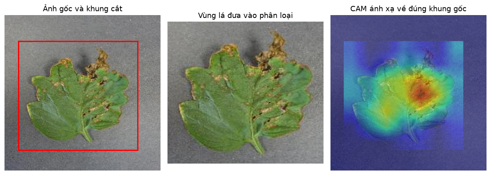
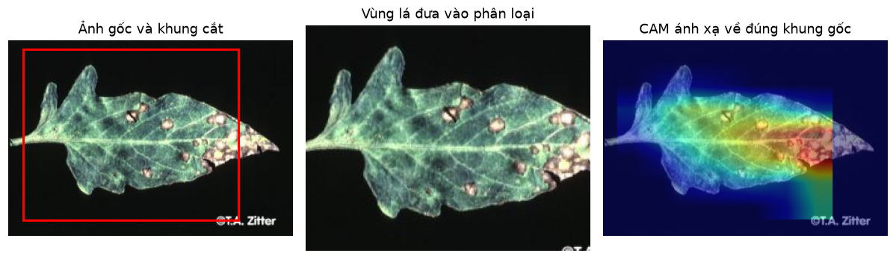
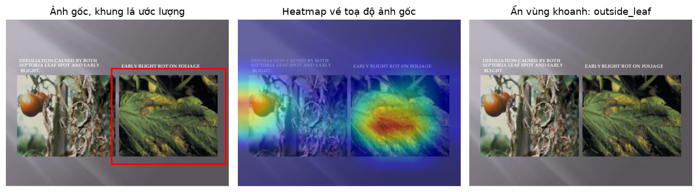

# Cắt vùng lá, chốt hiển thị XAI và cải thiện domain gap

Thực hiện [#93](https://github.com/GiaBaoK46DLU/AgriXAI/issues/93), [#90](https://github.com/GiaBaoK46DLU/AgriXAI/issues/90), [#50](https://github.com/GiaBaoK46DLU/AgriXAI/issues/50). Các số liệu dưới đây được sinh từ file dự đoán từng ảnh, không chỉnh tay.

Checkpoint được chọn bằng validation: **rehearsal**. Cắt lá trong cấu hình được chọn: **tắt**. Mặc định XAI vẫn là Grad-CAM++; bộ chặn lá chạy trước bước cắt, trên ảnh đầy đủ. Sau các lượt học, checkpoint và bước cắt được chốt bằng validation CPU (batch 1 như backend), trước khi mở test.
Chính sách chọn: giữ accuracy PV validation ít nhất 98,5%; trong các bản đạt điều kiện này, chọn macro-F1 PlantDoc validation cao nhất. Nhờ vậy mức đánh đổi trên dữ liệu nguồn được kiểm soát.

## 1. Thiết kế và dữ liệu

- Checkpoint cha EfficientNet-B0 giữ nguyên; không đổi thứ tự 10 lớp trong danh mục dùng chung.
- PlantDoc chỉ dùng thư mục train để học: bỏ `tomato_V8.jpg`, còn 674 ảnh; chia phân tầng seed 42 thành 539 ảnh học và 135 ảnh validation. Không dùng test để chọn epoch/cấu hình.
- Phép đo đích giữ đúng **66 ảnh test PlantDoc** đã lọc ba bản trùng byte từ bộ gốc. Đây là ảnh công khai từ Internet, không phải ảnh tự chụp ở Đà Lạt.
- Audit SHA-256 phát hiện thêm 5 bản sao trong train/val PlantVillage trùng test; đã bỏ khỏi dữ liệu học mới. Ba ảnh test từng có bản sao trong train của checkpoint cha được báo riêng qua cột PV sạch (2716 ảnh). Tập lịch sử 2719 ảnh vẫn giữ để so lại số cũ.
- Augmentation: ghép nền chỉ cho PlantVillage, nền chỉ từ split train của bộ ảnh âm; mô phỏng gamma, vùng nắng/bóng đổ, kèm jitter/blur hiện có. PlantDoc giữ nền thật, chỉ thay ánh sáng.
- Hai lần học đều bắt đầu từ checkpoint cha: augmentation trên PV; adaptation dùng 539 ảnh PlantDoc lặp 5 lần và 250 ảnh/lớp PV để giữ đủ 10 lớp. Batch 8, tích luỹ gradient 4 bước; AMP, AdamW, seed 42. Lượt batch 32 đầu bị dừng vì áp lực VRAM, chưa có checkpoint hoàn tất epoch.
- Sau fine-tune, thử hiệu chỉnh thống kê BatchNorm bằng ảnh train chưa augment: một biến thể dùng PV, một biến thể trộn PV/PlantDoc. Giữ nguyên mọi tham số đã học, chỉ cập nhật running mean/variance; dropout/stochastic depth tắt. Chỉ chọn biến thể bằng validation, trước khi mở test. Inventory hiệu chỉnh được kiểm tra không trùng validation/test.

## 2. Kết quả phân loại

**Bảng 1. Các hướng đã thử, cùng phép đo và không dùng test để chọn mô hình.**

| Phương án | PV 10 lớp | PV sạch | PV 8 lớp | PlantDoc 8 lớp | Macro-F1 PlantDoc |
|---|---:|---:|---:|---:|---:|
| Checkpoint cha, toàn ảnh | 99.60% | 99.59% | 99.60% | 28.79% | 0.2471 |
| Checkpoint cha, cắt lá | 99.26% | 99.26% | 99.38% | 30.30% | 0.2749 |
| Học thêm augmentation, toàn ảnh | 99.15% | 99.15% | 99.25% | 34.85% | 0.2608 |
| Fine-tune PlantDoc + PV, toàn ảnh | 97.68% | 97.68% | 97.52% | 56.06% | 0.5481 |
| Fine-tune + hiệu chỉnh BN bằng PV train | 96.65% | 96.65% | 97.30% | 45.45% | 0.4054 |
| Fine-tune + hiệu chỉnh BN bằng PV/PlantDoc train | 98.05% | 98.05% | 98.14% | 57.58% | 0.5607 |
| Fine-tune + nhắc lại PV và chưng cất từ checkpoint cha | 98.86% | 98.86% | 98.85% | 57.58% | 0.5510 |

Các hàng ở Bảng 1 được đo trên GPU. Backend cấu hình CPU nên được đo thêm riêng:

- PlantDoc test CPU: 28.79% → **57.58%**; macro-F1 8 lớp 0.5510.
- PlantVillage test CPU: 99.60% → 98.86%.
- Mức thay đổi accuracy trên PlantDoc CPU: +28.79 điểm; KTC ghép cặp 95% [+16.67; +40.91] điểm.

Không trộn số CPU với số GPU khi tính mức cải thiện. Các dự đoán khác nhau giữa hai thiết bị được ghi trong `cpu-gpu-disagreement.json`.

Có chạy thêm 3 epoch nhắc lại dữ liệu nguồn: 200 ảnh/lớp PV train và toàn bộ 539 ảnh PlantDoc train. Teacher là checkpoint cha; KL chưng cất (T=2, trọng số 0,5) chỉ áp trên PV, PlantDoc vẫn học nhãn thật. Tắt augmentation thay nền ở lượt này để giữ phong cách ảnh nguồn; vẫn giữ transform cơ bản. Inventory kiểm tra độc lập không trùng validation/test. Lịch sử, cả các epoch không được chọn, lưu trong `rehearsal-history.json`.

Trên 66 ảnh đích, thay đổi accuracy so với checkpoint cha: **+28.79 điểm phần trăm**; KTC bootstrap ghép cặp 95% [+16.67; +40.91] điểm; McNemar exact p = 0.000021. Có 20 ảnh từ sai thành đúng và 1 ảnh từ đúng thành sai.

66 ảnh là ít: kết luận chỉ trong bộ test này; không suy thành accuracy ngoài vườn. Đọc macro-F1 trên 8 lớp có mặt; mô hình vẫn trả đủ 10 lớp, hai lớp không có trong PlantDoc được kiểm lại trên PlantVillage. Không dùng con số gộp cả PlantDoc train+test của #49 để đánh giá checkpoint đã fine-tune.

**Bảng 2. Độ nhạy từng lớp trên PlantDoc test (đủ cả các lớp khó).**

| Lớp | Số ảnh | Recall trước | Recall sau | F1 sau |
|---|---:|---:|---:|---:|
| `bacterial_spot` | 8 | 12.50% | 37.50% | 0.4000 |
| `early_blight` | 9 | 66.67% | 66.67% | 0.6316 |
| `late_blight` | 10 | 60.00% | 80.00% | 0.7273 |
| `leaf_mold` | 6 | 16.67% | 66.67% | 0.4444 |
| `septoria_leaf_spot` | 10 | 30.00% | 80.00% | 0.7619 |
| `yellow_leaf_curl_virus` | 5 | 20.00% | 80.00% | 0.7273 |
| `mosaic_virus` | 10 | 0.00% | 10.00% | 0.1818 |
| `healthy` | 8 | 12.50% | 50.00% | 0.5333 |

**Bảng 3. Kết quả toàn hệ thống khi có bộ chặn lá.**

| Checkpoint | Tổng ảnh | Gate từ chối | Accuracy trên toàn bộ | Accuracy trong phần được nhận |
|---|---:|---:|---:|---:|
| baseline | 66 | 6 | 27.27% | 30.00% |
| selected | 66 | 6 | 56.06% | 61.67% |
| baseline-cpu | 66 | 6 | 27.27% | 30.00% |
| selected-cpu | 66 | 6 | 56.06% | 61.67% |

## 3. Cắt lá và độ tin cậy của vùng khoanh

Tách vùng bằng HSV/Otsu và thành phần nổi bật, lấp lỗ trong lá, thêm lề 8%. Không tách được vùng đủ rõ thì giữ ảnh đầy đủ. CAM của ảnh cắt được resize về khung cắt rồi đặt vào ảnh gốc; vùng ngoài khung bằng 0. Có kiểm thử ảnh không vuông/lá lệch tâm và đã xem bằng mắt 12 ảnh thật trong `coordinate-audit/`.

Cách tách màu còn giữ cả nhánh cây ở vài ảnh và bỏ sót mép lá khô ít bão hoà. Đây là heuristic cho tiền xử lý, chưa phải mô hình phân vùng lá hoặc phân vùng bệnh. Kết quả bật/tắt cuối cùng lấy từ validation; Bảng 1 ghi cả hai chế độ để đối chiếu.
Với checkpoint được chọn, accuracy PlantDoc validation CPU khi không cắt là 58.52%, khi bật cắt là 55.56%. Quyết định bật/tắt giữ nguyên khi mở test.



*Hình 1. Checkpoint cha, chế độ bật cắt để kiểm tra toạ độ: CAM chỉ nằm trong khung được đưa vào mô hình.*



*Hình 2. Ảnh validation PlantDoc cho thấy mép lá khô có thể bị bỏ sót. Hai hình kiểm toạ độ/giới hạn tiền xử lý, không phải số đo accuracy của checkpoint mới.*

Chốt XAI yêu cầu ít nhất **65.00% khối lượng heatmap nằm trong lá** và lift chuẩn hoá ≥ **0.05**; mask không rõ/CAM trống thì trả `heatmap=None`. Lift = (khối lượng trong lá − tỉ lệ diện tích lá)/(1 − tỉ lệ diện tích lá). Không dùng độ phẳng CAM để phân biệt domain. Các ngưỡng có trong YAML, giữ cố định trước khi mở test.

**Bảng 4. Kết quả trả `None` thực từ predictor; phân loại giữ nguyên khi bật/tắt chốt.**

| Bộ probe | Số ảnh | Không hiển thị heatmap | Tỉ lệ ẩn |
|---|---:|---:|---:|
| pv-validation | 300 | 80 | 26.67% |
| pd-validation | 135 | 85 | 62.96% |
| pv-test | 300 | 68 | 22.67% |
| pd-test | 66 | 43 | 65.15% |
| negative-test | 52 | 40 | 76.92% |

Lý do ẩn trên 300 ảnh PV test: `outside_leaf`: 37 ảnh; `unknown_leaf_mask`: 31 ảnh. `unknown_leaf_mask` là không tách được lá đủ rõ; `outside_leaf` là khối lượng/lift không đạt ngưỡng. Đây có thể là lá thật bị bỏ phần giải thích vì heuristic bảo thủ; không được coi các ảnh đó là ảnh không phải lá hoặc âm thầm bỏ khỏi phép đo.

Ảnh lá bị ẩn vẫn được tính đầy đủ trong độ chính xác. Ảnh âm ở bảng này được probe không có gate để đo riêng chốt XAI; hệ thống thật còn bộ chặn chạy phía trước. Qua chốt chỉ cho biết CAM tập trung vào vùng lá **ước lượng**, không chứng minh mô hình đoán đúng bệnh, vết khoanh là tổn thương thật, hay mức độ bệnh chính xác. Mặt nạ tham chiếu 56 ảnh hiện do AI khoanh mù, chưa được chuyên gia xác nhận.

Trong probe XAI trên GPU, accuracy nhóm PlantDoc qua chốt là 56.52%, so với 57.58% trên toàn bộ 66 ảnh. Chưa có bằng chứng chốt này dự báo được việc phân loại đúng/sai; mục đích là hạn chế vẽ vùng khi vị trí không đủ rõ.



*Hình 3. Checkpoint mới trên ảnh PlantDoc ghép nhiều nội dung: CAM phản ứng cả ở vùng quả; vùng khoanh được ẩn. Khung đỏ bên trái là khung lá ước lượng, không phải ảnh đầu vào đã cắt.*

## 4. Hiệu năng và tích hợp

**Bảng 5. Predict trên CPU, 32 ảnh sau một lượt làm nóng, cùng checkpoint được chọn.**

| Chế độ | Median (ms) | P95 (ms) |
|---|---:|---:|
| `crop_False_guard_False` | 54.04 | 105.06 |
| `crop_True_guard_False` | 59.22 | 101.48 |
| `crop_False_guard_True` | 54.77 | 62.85 |
| `crop_True_guard_True` | 53.55 | 56.39 |

Đây là thời gian `predict`, không gồm tải mô hình, mạng, lưu ảnh hoặc toàn bộ request. Máy có tác vụ khác nên không coi một lần đo là benchmark hiệu năng tổng quát.

Đã POST multipart qua FastAPI/TestClient bằng checkpoint thật, SQLite/thư mục ảnh tạm:

- `visible`: HTTP 201.
- `hidden`: HTTP 201; ảnh có vùng rõ có overlay, vùng không rõ không có overlay và nhắc chụp lại; ảnh bị gate chặn trả 422.
- `rejected`: HTTP 422.

Đã kiểm thêm HTTP thật qua Uvicorn riêng trên CPU: đăng ký cấp token thật, loader nạp checkpoint và YAML mặc định thật; ảnh có vùng rõ được ghi/đọc lại qua API và tải được overlay; vùng không rõ trả null kèm lời nhắc chụp lại; ảnh âm trả 422. SQLite và storage đều tạm, không dùng DB dev.
Phiên bản `/health` xác nhận: `efficientnet_b0-domain50-adaptation-domain-50-20261104-b8-rehearsal`.

Mỗi ca lặp cùng một ảnh ba lần để kiểm hợp đồng endpoint nhận 3–5 ảnh, không tính thành ba mẫu đánh giá độc lập. Không sửa `Prediction` hoặc danh mục lớp. Offline trên Flutter vẫn là CAM cổ điển với checkpoint cũ; không gán số đo nâng cấp server cho offline.

## 5. Tái lập và bằng chứng

Từ thư mục `model/`:

```powershell
python -m src.evaluation.verify_domain --run outputs/domain-50-20261104-b8
python -m src.evaluation.domain_report --run outputs/domain-50-20261104-b8
```

Nguồn: `model/outputs/domain-50-20261104-b8/`. `protocol.json`, inventory SHA-256, lịch sử từng epoch, `selection.json`, kết quả cắt trên validation, dự đoán từng ảnh test, bootstrap ghép cặp, kết quả từng probe XAI, phép đo hệ thống và response API được giữ nguyên để đối chiếu. Không chạy lại training/evaluation vào thư mục cũ; dùng `--out` mới.
