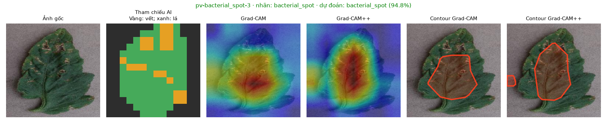
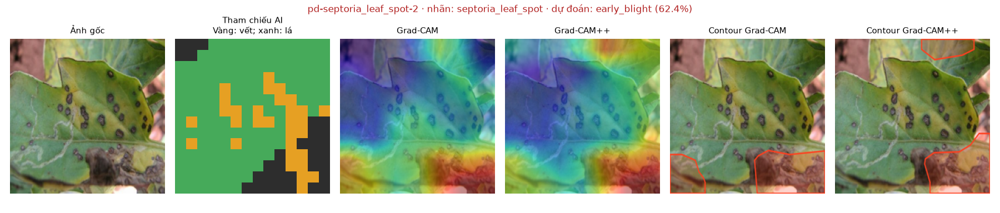

# Thực nghiệm nâng cấp Grad-CAM++ — issue #98

Ngày đo: 02/11/2026. Checkpoint: `efficientnet_b0-20260907-1443`.

## 1. Kết luận và quyết định cấu hình

Đã triển khai Grad-CAM++ có thể lựa chọn trong cấu hình, giữ Grad-CAM gốc để đối
chứng. Công thức tự cài khớp `pytorch-grad-cam==1.5.5` trên cả 56 ảnh: sai số tuyệt
đối lớn nhất **1,49 × 10⁻⁶**, IoU hai mặt nạ ngưỡng 0,62 bằng **1,0000**.

**Áp dụng `xai.method: gradcam_plusplus` làm mặc định ngày 02/11/2026 theo quyết định
triển khai trực tiếp của nhóm.** Grad-CAM++ cải thiện mức tập trung của
heatmap trên PlantVillage và một số chỉ số vết bệnh, nhưng chưa cải thiện ổn định
trên PlantDoc. Phần contour hiển thị ngoài lá trên PlantDoc tăng từ **22,59% lên
32,19%** ở ngưỡng đang dùng. Việc chọn mặc định là lựa chọn triển khai dựa trên các
lợi ích đã đo và chấp nhận giới hạn này; không phải bằng chứng bản ++ tốt hơn trên
mọi loại ảnh. Có thể quay lại `gradcam` qua cấu hình mà không đổi checkpoint.

[Bản Word ngắn, có bảng và hình so sánh](bao-cao-nang-cap-gradcam-plus-plus.docx).

Đây là kết quả thực nghiệm về **vùng giải thích**, không phải tăng độ chính xác
phân loại bệnh. Không huấn luyện lại, không thay trọng số, thứ tự lớp hoặc ảnh vào.
Phép chạy xác nhận tham số mô hình và xác suất dự đoán trước/sau sinh CAM không đổi.

## 2. Cách triển khai

`model/src/xai/gradcam_plusplus.py` bổ sung `GradCAMPlusPlus` cạnh lớp `GradCAM` gốc.
Giữ nguyên tệp thuật toán đối chứng để các thực nghiệm #17 và #122 vẫn kiểm chứng
được bằng hash mã nguồn cũ. Hai lớp dùng cùng target layer và giao diện gọi.

Với activation A và gradient logit g tại tầng cuối, hệ số theo công thức (19) là:

`alpha = g² / (2g² + sum_spatial(A) × g³ + epsilon)`.

Trọng số kênh là tổng theo không gian của `alpha × ReLU(g)`; cộng activation theo
trọng số rồi ReLU để có CAM. Dùng `epsilon = 10⁻⁶` giống thư viện đối chứng. Không
tính `exp(logit)` trực tiếp: hệ số chung đó bị triệt tiêu khi chuẩn hoá bản đồ;
CAM thô theo quy ước triển khai của thư viện, không dùng cường độ tuyệt đối để so
hai thuật toán.

Đã đọc trực quan trang 5 của bài gốc, đối chiếu phương trình (7), (19) và mục 3.3.
Sau target layer hiện tại của EfficientNet-B0 là GAP + Linear trong chế độ eval,
nên logit tuyến tính theo activation tại đó, phù hợp với công thức đóng. Không
suy rộng công thức này thành phép tính đạo hàm bậc cao chính xác cho mọi tầng SiLU
nông hơn.

Bản ++ lấy gradient bằng `torch.autograd.grad` tới activation cần thiết, không
ghi vào `.grad` của tham số và giải phóng activation/gradient sau mỗi lần gọi.
Lớp `GradCAM` cũ vẫn dùng `backward()` để giữ nguyên đối chứng lịch sử.

`DiseasePredictor` đọc `xai.method` từ `model/configs/default.yaml`; có thể chỉ
định riêng qua `xai_method`. Các trường `Prediction`, checkpoint và backend không
đổi. Heatmap vẫn được ánh xạ về đúng kích thước ảnh gốc bằng cùng hàm cũ.

## 3. Thiết kế thực nghiệm

- Dùng toàn bộ **56 ảnh cố định của #17**: 30 PlantVillage, 26 PlantDoc. Không chọn
  lại theo kết quả; đủ 6 ảnh `bacterial_spot` và 6 ảnh `septoria_leaf_spot`.
- Mỗi ảnh dùng cùng lớp mô hình dự đoán cho hai phương pháp; giữ cả ca dự đoán sai.
- Ảnh vào 224×224, chuẩn hoá ImageNet, target layer cuối cùng vẫn là **7×7**.
- Dùng mặt nạ lưới 14×14 đã khoanh mù từ trước. Đây là chú giải AI, **chưa được
  chuyên gia xác nhận**, không phải nhãn phân vùng bệnh chuẩn lâm sàng.
- 4 ảnh PlantDoc có cờ dữ liệu đáng ngờ vẫn được chạy/vẽ nhưng loại khỏi chỉ số
  không gian: `pd-bacterial_spot-1`, `pd-mosaic_virus-3`, `pd-spider_mites-1/2`.
- Chỉ số khối lượng/tập trung và điểm nóng trong lá dùng 30 PV + 22 PD. Nâng chuẩn
  hoá vào lá dùng 30 PV + 18 PD: thêm 4 ảnh có lá phủ toàn ảnh không có mẫu số hợp lệ.
- Chỉ số vết bệnh chính chỉ dùng ảnh **phân loại đúng, triệu chứng khu trú**:
  15 PV + 5 PD. Không ép một CAM đang giải thích lớp sai phải trùng nhãn bệnh thật.
- Contour sinh bằng **đúng hàm `draw_regions` của backend** ở kích thước ảnh gốc,
  ngưỡng vẽ **0,62**, giữ nguyên morphology, làm mượt, chọn tối đa 3 vùng và nét viền.
  Phần diện tích đo gồm vùng tô và viền hiển thị, không chỉ mặt nạ ngưỡng thô.
- Bootstrap 10.000 lần trên từng ảnh; so sánh chênh lệch theo cặp. Không coi các
  lần đo thời gian lặp là ảnh độc lập. Không dùng dữ liệu này để chọn ngưỡng mới.

## 4. Kết quả không gian

Mũi tên chỉ chiều tốt hơn. Mỗi ô là Grad-CAM → Grad-CAM++.

| Chỉ số | PlantVillage | PlantDoc |
|---|---:|---:|
| Khối lượng heatmap nằm trong lá ↑ | 68,61% → **78,93%** | 75,88% → 77,00% |
| Mức tập trung vào lá so với rải đều ↑ | 1,646 → **1,907** | 1,065 → 1,125 |
| Nâng chuẩn hoá vào lá ↑ | 0,409 → **0,597** | 0,042 → −0,026 |
| Điểm nóng lưới nằm trong lá ↑ | 93,33% → 93,33% | 77,27% → 63,64% |
| Phần contour hiển thị nằm ngoài lá ↓ | 4,61% → 6,22% | **22,59% → 32,19%** |
| Nâng chuẩn hoá vào vết bệnh ↑, chỉ ảnh đúng/khu trú | 0,098 → 0,128 | 0,217 → 0,257 |
| IoU contour với vùng vết bệnh ↑, chỉ ảnh đúng/khu trú | 0,171 → 0,173 | 0,228 → 0,270 |

Đối chiếu chênh lệch ++ trừ bản gốc:

- Nâng vào lá trên PV: **+0,188**, khoảng tin cậy 95% **[+0,145; +0,235]**.
- Nâng vào lá trên PD: **−0,068**, khoảng tin cậy **[−0,266; +0,116]** — chưa chứng
  minh được cải thiện.
- Phần contour ngoài lá trên PD: **+9,59 điểm phần trăm**, khoảng tin cậy
  **[+1,13; +18,44] điểm** — bất lợi cho vùng khoanh ở cấu hình hiện tại.
- Nâng vào vết bệnh gộp 20 ảnh đúng/khu trú: **+0,032**, khoảng tin cậy
  **[+0,012; +0,055]**. Đây là lợi ích trên tập audit nhỏ, không phải chứng minh
  toàn hệ thống nhận diện hoặc phân vùng chính xác hơn ngoài thực tế.
- IoU contour/vết bệnh gộp 20 ảnh: **+0,012**, khoảng tin cậy **[−0,008; +0,034]**.
  Chưa có bằng chứng tổng thể contour bám vết bệnh tốt hơn.

Không đặt trực tiếp các số mới cạnh số 42% hoặc 1,02× trong mô tả cũ của #98:
chúng dựa trên mặt nạ Otsu đã được #17 đính chính. Số mới dùng mặt nạ khoanh mù và
công bố rõ nhóm ảnh bị loại. Contour mới cũng dùng ngưỡng 0,62 và hình dạng thực tế,
khác phép đếm ô vượt ngưỡng 0,5 của báo cáo cũ.

## 5. Kiểm tra trực quan

Đã xem đủ **6 ảnh đốm vi khuẩn và 6 ảnh đốm mắt cua** ở cả hai bộ, gồm heatmap và
contour cuối. Toàn bộ 56 hình nằm trong
[`model/outputs/gradcam-plus-plus-98/figures/`](../model/outputs/gradcam-plus-plus-98/figures/).

- `pv-bacterial_spot-1`: bản ++ thu gọn vùng chú ý giữa lá, nhưng không chuyển
  được toàn bộ chú ý sang các vết cháy ở rìa.
- `pv-bacterial_spot-2`: giảm một số vùng khoanh phụ, vẫn còn vùng sát nền phía trên.
- `pv-bacterial_spot-3`: vùng chính dịch về phía trên, xuất hiện thêm contour nền nhỏ.
- `pd-bacterial_spot-1`: ảnh chứa cả quả; bản ++ chú ý thêm vào quả. Ảnh đã có cờ
  dữ liệu đáng ngờ nên không góp vào bảng chỉ số không gian.
- `pd-bacterial_spot-2`: vùng nóng dịch lên phần trên lá; nhãn vẫn sai như bản gốc.
- `pd-bacterial_spot-3`: giữ chú ý trên nhiều lá nhưng xuất hiện thêm vùng nền.
- `pv-septoria_leaf_spot-1`: contour ++ rộng hơn và có vùng phụ ngoài lá.
- `pv-septoria_leaf_spot-2`: thêm vùng giữa lá; vẫn giữ vùng trên mép/nền.
- `pv-septoria_leaf_spot-3`: hai contour khá giống nhau, không giải quyết từng đốm nhỏ.
- `pd-septoria_leaf_spot-1/2/3`: đều dự đoán sai lớp; ++ vẫn có vùng chú ý ngoài lá
  hoặc không trúng cụm đốm cần quan tâm. Không đổi thuật toán giải thích thành
  bằng chứng rằng mô hình đã học đúng bệnh.

Ví dụ đối chiếu, mỗi hàng gồm ảnh gốc, tham chiếu AI, hai heatmap và hai contour:





## 6. Thời gian và nhánh ngoại tuyến

Đo trên CPU Intel Core i5-13400F, 4 luồng PyTorch, khởi động 3 lượt cho mỗi thuật
toán, lặp 3 lần/ảnh, luân phiên thứ tự đo hai phương pháp giữa các ảnh.

| Cài đặt | Trung bình | Khoảng tin cậy 95% |
|---|---:|---:|
| Grad-CAM gốc | 55,75 ms | 55,03–56,47 ms |
| Grad-CAM++ mới | 21,81 ms | 21,29–22,36 ms |

Đây là thời gian tạo CAM thô 224×224: gồm forward, gradient, nội suy và sao chép
kết quả sang NumPy; không gồm nạp mô hình, dự đoán chung ban đầu, chuẩn hoá NumPy,
vẽ contour, mạng, CSDL hay giao diện. Bản mới nhanh hơn còn do **tối ưu lấy gradient
tới activation**, trong khi bản đối chứng cũ gọi `backward()` trên toàn đồ thị.
Không kết luận bản chất thuật toán Grad-CAM++ nhanh hơn Grad-CAM 2,56 lần, và không
so trực tiếp con số này với phép đo có phạm vi khác trong #18/#122.

Nhánh ONNX/Dart tiếp tục dùng CAM cổ điển, không thay file mô hình mobile. Nếu bật
`gradcam_plusplus` ở server, **vùng khoanh online/offline có thể khác nhau** dù
checkpoint phân loại không đổi. Lựa chọn mặc định ++ hiện chỉ áp dụng cho server
PyTorch; nhánh offline giữ nguyên CAM cổ điển và phải được mô tả đúng khi báo cáo.

## 7. Bật thử, chạy lại và kiểm chứng

Từ thư mục `model/`, trong môi trường thực nghiệm riêng đã có dependencies mô hình:

```powershell
python -m pip install -r requirements.txt -r requirements-xai-validation.txt
$env:PYTHONUTF8 = '1'
$env:DEBUG = 'false'
$env:DATABASE_URL = 'sqlite:///:memory:'
python -m pytest tests -q -p no:cacheprovider
python -m src.evaluation.compare_gradcam_plusplus --out outputs/gradcam-plus-plus-98-new
python -m src.evaluation.verify_gradcam_plusplus --out outputs/gradcam-plus-plus-98-new
```

Hai biến DEBUG/DATABASE_URL chỉ áp dụng cho tiến trình đo khi import bộ vẽ backend;
không ghi `.env`, không kết nối hay thay dữ liệu hệ thống. Cần ảnh gốc/manifest
của #17 ở máy để chạy lại. Chương trình từ chối ghi đè thư mục đã có `protocol.json`.

Kiểm chứng bản kết quả đã lưu bằng:

```powershell
python -m src.evaluation.verify_gradcam_plusplus
```

Đầu ra gồm `protocol.json` (cấu hình, hash checkpoint/mã nguồn/mặt nạ/ảnh),
`per-image.json` (112 bản ghi), `summary.json`, 56 tệp NPZ chứa hai CAM thô và hai
CAM chuẩn hoá, 56 hình so sánh, `verification.json`. Hash văn bản chuẩn hoá xuống
dòng LF để Git trên Windows/Linux không gây sai lệch giả. Hash ảnh/checkpoint là
hash byte nguyên trạng.

Đã chạy **23 test thành công, không có test bị bỏ qua** trong môi trường thực nghiệm.
Bao gồm đối chứng trọng số với thư viện, gradient bằng 0, batch nhiều lớp, dọn hook,
không đổi tham số/gradient mô hình và hợp đồng `Prediction`. Kiểm tra checkpoint thật
xác nhận constructor mặc định đọc cấu hình ++ thành công, ba ảnh không vuông vẫn có heatmap đúng kích
thước và xác suất giống bản gốc, `with_heatmap=False` vẫn hoạt động, bộ chặn thật vẫn
từ chối ảnh âm trước khi tạo CAM. Kết quả thao tác tích hợp lưu trong `integration.json`.

Lệnh CLI `src.xai.visualize --xai-method gradcam_plusplus --num 12` cũng đã chạy thật;
lưới lưu ở `figures/luoi-12-anh-test.png`. Đây là kiểm tra CLI riêng, không thêm 12 ảnh
này vào tập 56 ảnh thống kê.

Mặc định sản phẩm đã đặt `xai.method: gradcam_plusplus`; khởi động lại backend đang
chạy để predictor được nạp lại. Dùng constructor/CLI trong `model/README.md` để
chọn riêng, hoặc đổi cấu hình thành `gradcam` rồi khởi động lại để quay về bản cũ.
Không cần sửa hợp đồng `Prediction` hoặc danh mục bệnh.

## 8. Giới hạn

Grad-CAM++ không làm lưới 7×7 thành bộ phân vùng từng vết bệnh, không sửa domain gap,
không tự chữa chuẩn hoá min-max của CAM yếu (#90). Chưa tinh chỉnh ngưỡng riêng cho
bản ++; nếu làm tiếp phải chọn trên tập validation riêng rồi đánh giá tập giữ lại,
không dò ngưỡng trên cả 56 ảnh rồi dùng cùng 56 ảnh để công bố cải thiện.

Thực nghiệm này chưa đo deletion/insertion AUC cho bản ++, chưa phải đánh giá người
dùng hay chuyên gia bệnh học. Kết luận chỉ áp dụng cho các chỉ số không gian và
thời gian đã đo, không suy ra độ trung thực nhân quả hoặc mức độ bệnh.

## 9. Nguồn

- Chattopadhyay et al., [Grad-CAM++: Improved Visual Explanations for Deep
  Convolutional Networks](https://arxiv.org/pdf/1710.11063), v3, mục 3.3, công thức (7), (19).
- [pytorch-grad-cam 1.5.5](https://pypi.org/project/grad-cam/1.5.5/), đối chứng
  trực tiếp lớp `GradCAMPlusPlus` trong môi trường đo.
- [Kiểm vùng lá/vết bệnh #17](bao-cao-kiem-gradcam-vet-benh.md), nguồn tập audit và mặt nạ.
- [Issue #98](https://github.com/GiaBaoK46DLU/AgriXAI/issues/98), phạm vi triển khai và cổng đổi mặc định.
